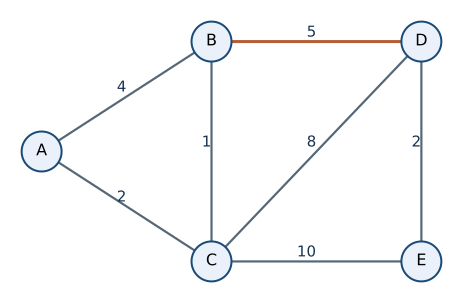
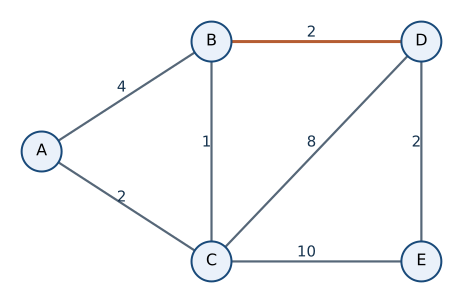

# Atividade 13 — Algoritmos de Roteamento

Implementações comentadas em **C11** de **Bellman-Ford (vetor de distâncias)** e **Dijkstra (estado de enlace)**, acompanhadas dos resultados experimentais para a atividade de Laboratório de Redes de Computadores.

## Topologia dos roteadores

O mesmo grafo de **5 roteadores (A–E)** é utilizado nos dois programas. Todos têm pelo menos **2 enlaces bidirecionais**: A (2), B (3), C (4), D (3) e E (2). Cada roteador também possui uma tabela com rotas para todos os demais.

**Cenário inicial — B-D = 5**



**Cenário final — B-D = 2**



| Enlace | Inicial | Final |
|---|---:|---:|
| A–B | 4 | 4 |
| A–C | 2 | 2 |
| B–C | 1 | 1 |
| **B–D** | **5** | **2** |
| C–D | 8 | 8 |
| C–E | 10 | 10 |
| D–E | 2 | 2 |

## Como compilar e executar

Requisito: compilador **GCC compatível com C11**. Os exemplos não exigem bibliotecas externas.

### Linux ou macOS com GCC e Make

```bash
make
./bellman_ford
./dijkstra
make test
```

### Windows (PowerShell + GCC, por exemplo MinGW-w64)

Execute na pasta principal do projeto:

```powershell
gcc -std=c11 -Wall -Wextra -pedantic src/network.c src/bellman_ford.c -o bellman_ford.exe
gcc -std=c11 -Wall -Wextra -pedantic src/network.c src/dijkstra.c -o dijkstra.exe
.\bellman_ford.exe
.\dijkstra.exe
python tests/test_results.py
```

Para salvar a execução em arquivos de texto no PowerShell:

```powershell
.\bellman_ford.exe | Out-File -Encoding utf8 resultados/bellman_ford.txt
.\dijkstra.exe | Out-File -Encoding utf8 resultados/dijkstra.txt
```

**Nota:** as saídas já foram geradas e incluídas neste repositório. Ao executar os programas, os resultados são recalculados usando os custos definidos em `src/network.c`.

## O que aparece nos programas

- **Bellman-Ford:** custos diretos na rodada 0; atualização simultânea dos vetores em rodadas; momento de estabilização; tabelas de todas as origens com custo e próximo salto, para a topologia inicial e final.
- **Dijkstra:** seleção sucessiva dos roteadores e relaxamento dos custos a partir de A; tabelas de todas as origens com custo e próximo salto, para a topologia inicial e final.

### Exemplo comparativo

| Rota a partir de A | Antes de alterar B–D | Depois de alterar B–D |
|---|---:|---:|
| A → B | 3 | 3 |
| A → C | 2 | 2 |
| A → D | **8** | **5** |
| A → E | **10** | **7** |

Os dois programas produzem as mesmas matrizes de menores custos. Como exemplo, a rota **A → C → B → D → E** passa de custo **10** para **7** após a atualização de B–D.

## Estrutura do repositório

```text
.
├── README.md
├── Makefile
├── .gitignore
├── .github/workflows/ci.yml
├── src/
│   ├── network.h          # Rede de 5 roteadores e API compartilhada
│   ├── network.c          # Topologia e impressao das tabelas
│   ├── bellman_ford.c     # Vetor de distancias por rodadas
│   └── dijkstra.c         # Estado de enlace e relaxamento
├── assets/
│   ├── topologia_inicial.svg
│   ├── topologia_final.svg
│   ├── topologia_inicial.dot
│   └── topologia_final.dot
├── resultados/
│   ├── bellman_ford.txt
│   └── dijkstra.txt
└── tests/
    └── test_results.py   # Confere as distancias e os proximos saltos
```

## Limitações técnicas

Simulação didática de topologias estáticas. Não implementa RIP ou OSPF completos, nem envio de pacotes por sockets. Bellman-Ford é implementado conforme a formulação de **vetor de distâncias com trocas síncronas de estimativas**; Dijkstra é executado de forma independente em cada origem. Os custos são estritamente positivos e os enlaces, bidirecionais.

**Referências de apoio:** [RFC 2453 (RIP)](https://www.rfc-editor.org/rfc/rfc2453.html) e [RFC 2328 (OSPF)](https://www.rfc-editor.org/rfc/rfc2328.html).
